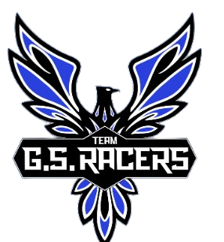

  

# Team GS Racers

The SAE collegiate club at **Shri G.S. Institute of Technology & Science (SGSITS), Indore**. We design, build and race.

Three student teams, one club:

| Team | What we do |
|---|---|
| **Formula** | Madhya Pradesh's first Formula Student team — designing and racing single-seat formula student cars. |
| **Baja** | Off-road Baja ATVs built to conquer the toughest terrain. Engineering and racing since 2007. |
| **Aero** | FPV racers, autonomous UAVs and payload drones — engineering flight from the ground up. |

## Find us

- Website: [teamgsracers.in](https://www.teamgsracers.in)
- Instagram: [@team_gsracers](https://www.instagram.com/team_gsracers) · Formula: [@team_gsracers_fs](https://www.instagram.com/team_gsracers_fs) · Aero (Yan): [@team_gsracers_yan](https://www.instagram.com/team_gsracers_yan)
- LinkedIn: [Team GS Racers](https://www.linkedin.com/company/gsracers/)
- YouTube: [GS Racers](https://youtube.com/@teamgsracerssgsits6635)
- Email: [teamgsracers.org@gmail.com](mailto:teamgsracers.org@gmail.com)

## Join us

Students at SGSITS can apply through the [join form](https://www.teamgsracers.in/join) on our website.

## Sponsors and partners

Interested in supporting the teams? Write to us at the email above.
